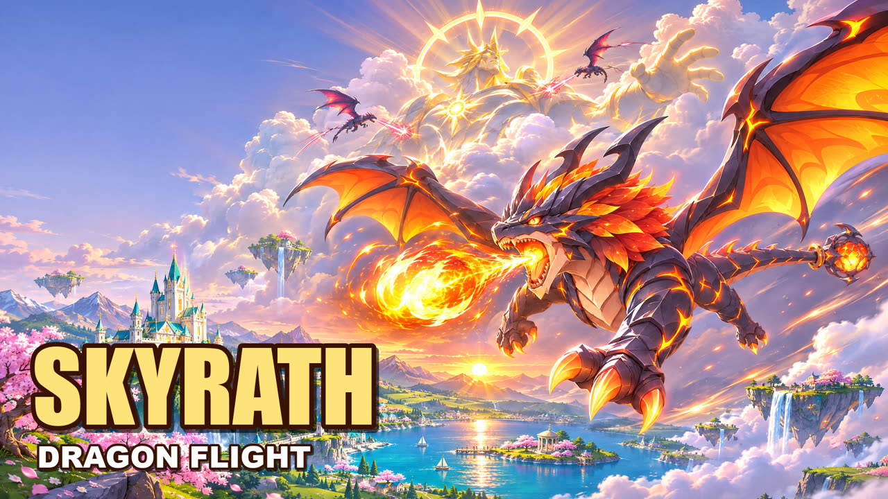
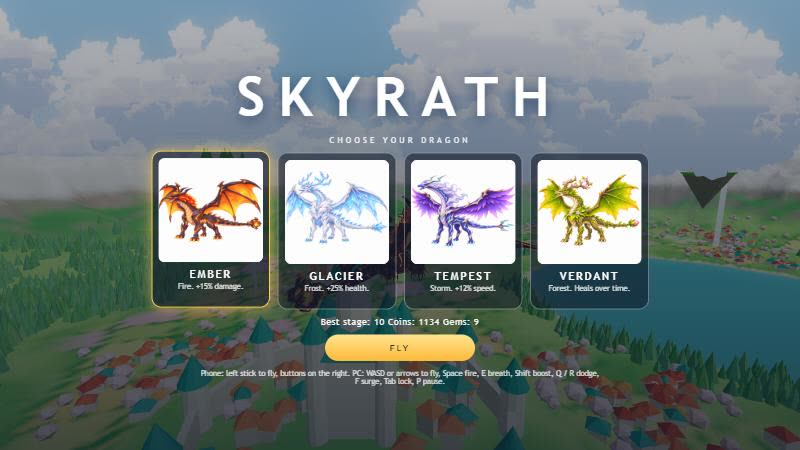
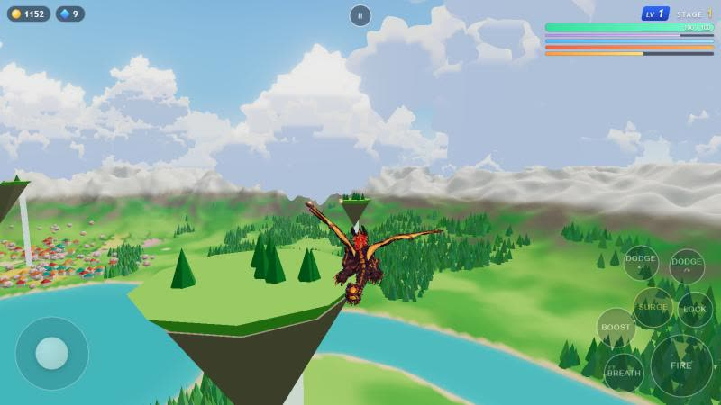
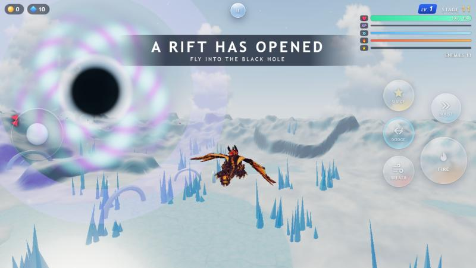
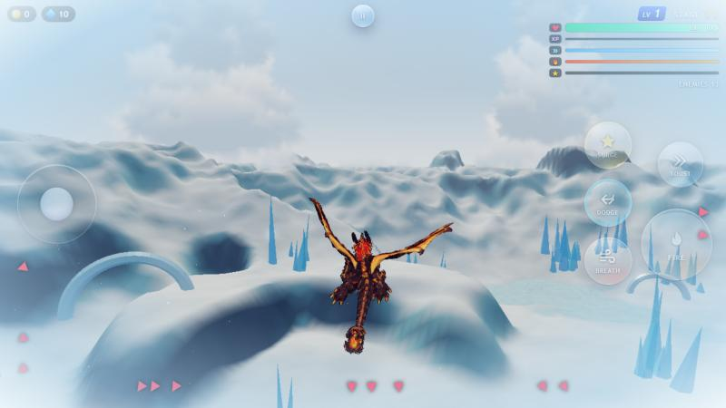

<p align="center"></p>

# Skyrath — Dragon Flight

A 3D dragon flight combat game for the browser, phones and PC, built with **Three.js** and plain JavaScript (no game engine).
Fly one of four elemental dragons, defend a sky kingdom from enemy drakes, defeat giant god bosses, and tear open a black hole
into a frozen crystal world.

**▶ Play it:** [CrazyGames](https://www.crazygames.com/game/skyrath) · [itch.io](https://devilexxon.itch.io/skyrath)

Made by **Sabbir Ahmed Shuvo** ([DevilExxon](https://devilexxon.itch.io/)), a CSE student who wants to make games.

| | |
|---|---|
|  |  |
|  |  |

## Features

- **4 elemental dragons** (fire, frost, storm, forest) plus 2 legendary dragons and 8 unlockable skins, each with its own attacks
- **Two worlds**: the Sky Kingdom, with a castle, villages, rivers, floating islands and waterfalls, and the Crystal Expanse, with a frozen sea, ice spires, northern lights and snow. Both are generated in code, so they add almost nothing to the download.
- **Black hole portal** after every 10th stage boss, with a warp-tunnel transition between worlds
- **God bosses** with weak points, plus enemy types that need different tactics: shield drakes (flank them), diving imps (dodge them), snipers (red warning beam), menders (heal other enemies) and gold elites
- **Solid world**: trees, houses, rocks and the castle all have collision; crashing hurts and bounces you off
- **World hazards**: falling ice shards with a warning circle, and freezing wind zones
- **Progression**: levels, upgrades, a shop, a 7-day login calendar, 3 daily missions, 12 achievements and personal bests
- **Cloud save** on Android with Google Play Games: progress follows the player's Google account across reinstalls and phones
- **Story intro** with voiced lines, music and sound effects
- **Runs everywhere**: Google Play (Android), CrazyGames (with their SDK) and the web (itch.io), all from one codebase

## Tech

| Area | What's used |
|---|---|
| Rendering | Three.js r170 (ES modules), toon materials, UnrealBloom post-processing, custom GLSL shaders (waterfalls, ice cracks, aurora, black-hole swirl, GPU snow) |
| Code | Plain JavaScript (about 6,000 lines), no framework or bundler |
| Audio | Web Audio API: decoded effect buffers, streamed music through gain nodes |
| Platforms | CrazyGames SDK v3 (cloud saves, rewarded and midgame ads); Android app (Gradle, WebView + Google Play Games cloud save) for Google Play |
| Tooling | Node.js build script, Python and Node scripts for model and texture work, ffmpeg |

## Challenges I solved

- **Collisions without heavy physics.** Every tree, house, rock and castle piece registers a simple shape (cylinder, sphere or rotated box) in a 100 m spatial grid, so each frame only checks nearby shapes: about 1 µs per check, with no physics engine and no extra download.
- **Two songs playing at once on iPhone.** iOS ignores the `volume` property of `<audio>` elements, so music fade-outs never finished and old tracks kept playing. I moved all audio to the Web Audio API, which also fixed the volume sliders on iPhone.
- **Lag on phones.** Sound effects used to restart a media player on every shot, which stalls iOS. They are now decoded once and played from buffers, with a cap on how many play at once. Graphics quality also lowers itself automatically when the frame rate drops.
- **A new world without a bigger download.** The crystal world's terrain, ice and sky are generated procedurally with shaders, and enemies are recoloured instead of using new models, so the world adds only kilobytes.
- **One codebase, three stores.** The build script injects the target platform and copies only the assets the game loads. Models ship with shrunk textures, so the initial download is about 16 MB.
- **Never losing progress.** On Android, the save is mirrored to the player's Google account through Google Play Games
  (Saved Games), via a small Java bridge into the game's web view. Each save carries a line ID and a revision number, so a
  fresh install restores the cloud copy, the newest copy wins on the same save line, and the player chooses only when two
  different saves both have real progress. A restore never interrupts a run.
- **Phone controls on many screen sizes.** The on-screen buttons lay themselves out to avoid overlapping the HUD bars on small and notched screens.

## Controls

| | Phone | PC |
|---|---|---|
| Fly (turn, climb, dive) | Joystick | W A S D / arrow keys |
| Fire (hold to charge) | FIRE | Space / left click |
| Breath | BREATH | Right click |
| Boost | BOOST | Shift |
| Dodge | DODGE | Q / E |
| Surge (ultimate) | SURGE | F |
| Pause | II | Esc / P |

Aim is auto-lock: point the dragon at an enemy and it locks on.

## Run it locally

You need [Node.js](https://nodejs.org/) 18 or newer.

```bash
node tools/serve.mjs 5173
```

Then open http://localhost:5173/. On Windows you can also double-click `Play Skyrath.bat`. The server also prints an address for phones on the same Wi-Fi.

## Build

```bash
node tools/build_web.mjs web          # itch.io / any web host  -> dist/web
node tools/build_web.mjs crazygames   # CrazyGames (adds their SDK) -> dist/web-crazygames
node tools/build_web.mjs android      # then: bash tools/build_android.sh unsigned  (Gradle: Google Play bundle)
                                      #   and sign it: powershell -ExecutionPolicy Bypass -File tools/android_key.ps1 sign
                                      #   needs JDK 17 and the Android SDK (platform 36); Gradle is downloaded by the wrapper
```

The build scripts use ffmpeg to shrink images. The Google Play bundle is signed with a private upload key kept outside the project; signing keys are never committed.

Privacy policy: [devilexxon.github.io/skyrath/privacy.html](https://devilexxon.github.io/skyrath/privacy.html)

## Project layout

```
game/            index.html, style.css and the game code (game/src/*.js)
  src/main.js      game loop, player, enemies, HUD, menus
  src/world.js     Sky Kingdom terrain, props, collisions, waterfalls, world themes
  src/crystal.js   Crystal Expanse world
  src/portal.js    black-hole portal
  src/gods.js      god bosses
  src/meta.js      daily rewards, missions, achievements
  src/audio.js     Web Audio music, effects and voices
  src/cloud.js     cloud save sync (Android: Google Play Games)
  src/platform.js  CrazyGames SDK layer
assets/          optimized 3D models, audio, dragon card art and skins
vendor/          Three.js
tools/           build, dev-server and asset scripts
android/         Android app (Gradle project: WebView + Google Play Games cloud save bridge)
docs/            screenshots for this README
```

## How it was made

I designed and directed Skyrath, and built it with AI assistance. I chose the features, the look and the difficulty,
tested every version on real devices (Android, iPhone and PC), and shipped it to CrazyGames and itch.io.

| Tool | What I used it for |
|---|---|
| [Claude](https://claude.ai/) (Claude Code) | Writing and debugging the game code, build scripts and shaders |
| [VS Code](https://code.visualstudio.com/) | Editing and running the project |
| [Meshy AI](https://www.meshy.ai/) | Generating the 3D dragon and god models |
| [Blender](https://www.blender.org/) | Rigging, cleaning up and exporting the models |
| [ChatGPT image generation](https://chatgpt.com/) | Concept art, dragon cards and skins |
| [Higgsfield](https://higgsfield.ai/) | Art and promotional images |
| [ElevenLabs](https://elevenlabs.io/) | Music, sound effects and voice lines |

## License

- **Code** (everything except `assets/` and `docs/`): [MIT](LICENSE)
- **Art, models, audio and screenshots** (`assets/`, `docs/`): all rights reserved; see [ASSETS-LICENSE.md](ASSETS-LICENSE.md)
- Three.js (`vendor/`) is MIT licensed by its authors.
